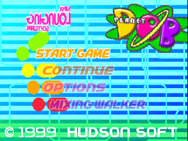
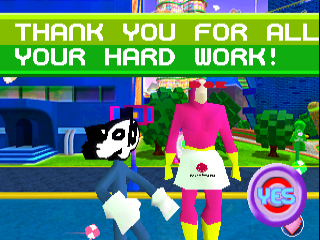
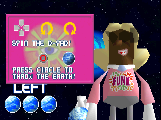
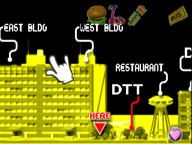

# Planet Dob — English Translation

An English fan translation of **Planet Dob**, the Japanese-exclusive PlayStation game.

[YouTube](https://www.youtube.com/@lifeisfullofbotox) · [Ko-fi](https://ko-fi.com/lifeisfullofbotox)

---

## About the project

Bringing Planet Dob's strange, colorful world to English-speaking players.

## Screenshots

<table>
  <tr>
    <td align="center"> Title screen</td>
    <td align="center"> Dialogue</td>
  </tr>
  <tr>
    <td align="center"> Instructions</td>
    <td align="center"> Map</td>
  </tr>
</table>

## Development

**Status: In development.**

This repository is the public home for the project. Updates, technical notes, and future patch releases will be shared here as work progresses.

Patch downloads, when available, will appear under [Releases](https://github.com/lifeisfullofbotox/planetdob-en/releases).

## Follow and support

Follow development on [YouTube](https://www.youtube.com/@lifeisfullofbotox).

If you'd like to give the project a boost, you can [support the work on Ko-fi](https://ko-fi.com/lifeisfullofbotox). Thank you for helping me keep it moving.

